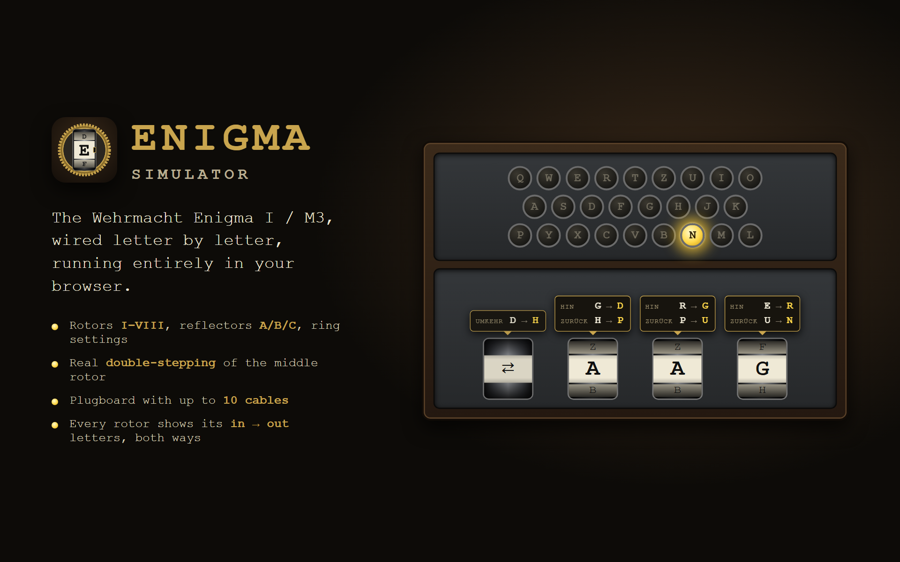

# Enigma Simulator


[](LICENSE)



**A working simulation of the Wehrmacht Enigma I / M3 cipher machine, with every step of the signal on show.**

▶️ **Try it:** <https://kreaton.github.io/EnigmaSimulator/>

Press a key and the rotors step, the lamp lights, and every rotor shows which letter went in and which came out, on the way to the reflector and back. It is a Blazor WebAssembly app (.NET 10) that runs entirely in the browser, with no server or backend. Like the real machine, the labels are in German.

## The machine

- **Walzen** (rotors): three of I–VIII, each with its historical wiring and turnover notch(es). VI–VIII have two notches.
- **Umkehrwalze** (reflector): UKW-A, B or C.
- **Ringstellung** (ring setting) per rotor, and the **Grundstellung** (start position) set with ▲ / ▼.
- **Stepping**, including the real double-step of the middle rotor (the sequence ADU → ADV → AEW → BFX → BFY).
- **Steckerbrett** (plugboard): click two sockets to patch a cable, click a used socket to pull it. At most 10 cables, or **Zufällig stecken** for a random set.
- **Tastatur / Lampenfeld**: the German QWERTZ layout. Click the keys or type A–Z. Like the real machine, the keyboard locks while a key is held down.

## Following the signal

While a key is down, and for a moment after, a popup above each rotor shows the letter going **in** and coming **out**:

| | |
|---|---|
| **hin** | the way in, right → middle → left rotor |
| **Umkehr** | through the reflector |
| **zurück** | the way back, left → middle → right rotor |

Hovering a rotor shows its popup again for the last letter. The **Signalweg** panel lists the whole path: keyboard → plugboard → R → M → L → UKW → L → M → R → plugboard → lamp.

## Paper tape

Each key press adds to the **Klartext** (plain text) and **Geheimtext** (cipher text) tapes, in groups of five. Paste a whole message into the text box and press **Ver-/Entschlüsseln** to run it through in one go (Ä/Ö/Ü become AE/OE/UE, ß becomes SS, and anything that isn't a letter is dropped).

The Enigma is reciprocal: set the machine back to the same start position (**Grundstellung**) and type the cipher text, and the plain text comes out.

## Project layout

```
EnigmaSimulator.slnx
src/EnigmaSimulator/
  Core/EnigmaMachine.cs     Rotor and reflector wiring, stepping, plugboard and the signal path
  Pages/Home.razor          The machine: lamps, rotors with their popups, keyboard, plugboard and tapes
  BuildInfo.cs              Version, build time and commit shown in the footer
  wwwroot/
    index.html              Host page, <base href>
    css/app.css             All styling
    manifest.webmanifest
    icons/                  App icons and favicon (favicon.svg is the source)
tests/EnigmaSimulator.Tests/
  Program.cs                Checks the machine against known values (no browser)
tools/
  make-icons.ps1            Renders the PNG icons from favicon.svg
  banner.html               The README banner
  make-banner.ps1           Renders banner.html to images/banner.png
```

## Running locally

Requires the [.NET 10 SDK](https://dotnet.microsoft.com/download).

```bash
dotnet run --project src/EnigmaSimulator
```

Then open http://localhost:5141.

Stop the app before building it again. A running dev server keeps the list of files it started with, and after a rebuild the page can hang while loading.

## Tests

```bash
dotnet run --project tests/EnigmaSimulator.Tests
```

The test runner checks the machine logic against known values: AAAAA → BDZGO and 25 × A with rotors I-II-III on UKW-B, the double-step sequence, reciprocity with plugboard, ring settings, rotors VI–VIII and UKW-C, that no letter ever encrypts to itself, and the plugboard rules. The exit code is the number of failed checks.

## Publishing

Pushing to `main` runs the tests, builds the app and deploys it to GitHub Pages (<https://kreaton.github.io/EnigmaSimulator/>) with [`.github/workflows/deploy.yml`](.github/workflows/deploy.yml). The version is `1.0.<run number>`, set in [`Directory.Build.props`](Directory.Build.props).

Pages serves the app from `/EnigmaSimulator/`, so the workflow rewrites `<base href="/" />` in `index.html` to match.

## Icons and banner

Both are made with Windows PowerShell and headless Edge:

```bash
powershell -File tools/make-icons.ps1
powershell -File tools/make-banner.ps1
```

## License

[MIT](LICENSE) © 2026 Per Hejndorf, Kreaton
